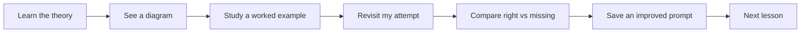

# Better Prompts, Better Results — My ChatGPT Learning Notebook

*A practical, personal guide to prompting and using ChatGPT effectively.*

This repository documents my six-lesson learning journey. It is **not** a collection of magic phrases. It is a reference I can return to whenever an AI response is vague, off-target, poorly supported, or difficult to use.

Every lesson is organised like the live lessons I enjoyed:

1. **Theory** — the concept, explained simply but accurately.
2. **Visual diagram** — a map of how the concept works (renders directly on GitHub).
3. **Worked example** — compare weak and improved prompting *before* attempting it.
4. **My original prompt** — my exact wording, preserved so I can revisit my thought process.
5. **What I did right / what I missed** — concrete feedback, not just a score.
6. **Improved prompt** — a reusable version and, where useful, a shorter alternative.
7. **Takeaway and next lesson** — one principle to remember and an easy navigation link.

Lesson 6 is a final synthesis; there wasn't a personal written exercise for it, so none has been invented.



> The exercise scores are informal teaching feedback, **not scientific measurements** of prompt quality. The fifth exercise was assigned before a sufficiently complete technical demonstration; its score should not be treated as an assessment of ability.

## Start here

| Lesson | Focus | My exercise feedback |
|---|---|---|
| [01 — Structure a useful request](lessons/01-goal-context-constraints-output.md) | Goal, Context, Constraints, Output | 7/10 |
| [02 — Context engineering](lessons/02-context-engineering.md) | What to include, omit, and retrieve | 8.5/10 |
| [03 — Control the approach](lessons/03-research-tools-and-format.md) | Research, tools, reasoning, formatting | 8/10 |
| [04 — Improve through feedback](lessons/04-iterative-prompting.md) | Preserve, Correct, Redirect | 9/10 |
| [05 — Technical prompt patterns](lessons/05-zero-shot-few-shot-and-json.md) | Zero-shot, few-shot, JSON, decomposition | 5/10* |
| [06 — ChatGPT as a work assistant](lessons/06-real-world-workflows.md) | Combining techniques into finished work | No scored exercise |

**Quick reference:** [Replace generic words with precise requests](PROMPT-PHRASEBOOK.md) — short phrases you can copy into almost any conversation.

> **Reading tip:** Start at Lesson 1 and follow the "Next" link at the bottom of each lesson, or jump straight to a lesson when a real ChatGPT response goes wrong.

## The key mental model

A useful request answers as many of these questions as necessary:

- **Goal:** What outcome do I want?
- **Context:** What does the assistant need to know?
- **Constraints:** Which limits, preferences, and exclusions matter?
- **Method:** Should it explain, research, calculate, code, or compare?
- **Evidence:** What must be verified, and how should uncertainty be handled?
- **Output:** What should I receive: a short answer, comparison, plan, code, or actual file?

You rarely need all six for a simple question. The goal is **relevance and precision**, not a long prompt.

### A compact reusable prompt

```text
Goal: [What I'm trying to achieve]
Context: [Only relevant background]
Constraints: [Budget, time, location, exclusions]
Approach: [Research / compare / calculate / explain / build]
Evidence: [Sources, assumptions, uncertainties to verify]
Output: [Exactly what I want back]
If critical information is missing, ask one focused question;
otherwise proceed with clearly stated assumptions.
```

### Before and after in 20 seconds

**Generic:** “Find me a good job.”

**Effective:** “Find currently open entry-level data or AI positions in Paphos, Limassol, or remote roles accepting Cyprus applicants. Use official application pages when possible. Compare required skills against my academic Python/ML background; explain gaps rather than inventing interview odds. Return up to five credible matches with source links, pros/cons, and the top three I should prioritise.”

The second version clarifies the **outcome**, **scope**, **evidence**, **evaluation**, and **deliverable**.

## Three things to keep in mind

1. **Prompting cannot create missing information.** Current facts require current evidence; model-generated numbers are not automatically verified.
2. **The right tool matters.** Web search for changing facts, Python for calculations and datasets, document tools for downloadable files, connected apps for permitted account actions.
3. **An improved prompt is a hypothesis.** For repeated tasks, test several prompts against the same examples and track accuracy, output validity, cost, and failure modes. That will be our separate Python evaluation project.

## How to use this repository

- If an answer is vague, open [Lesson 1](lessons/01-goal-context-constraints-output.md).
- If ChatGPT focuses on irrelevant details, open [Lesson 2](lessons/02-context-engineering.md).
- If you need accurate research or the right tool, open [Lesson 3](lessons/03-research-tools-and-format.md).
- If the first answer missed your intention, open [Lesson 4](lessons/04-iterative-prompting.md).
- If you're building an LLM application, open [Lesson 5](lessons/05-zero-shot-few-shot-and-json.md).
- If you want to assign a whole piece of work, open [Lesson 6](lessons/06-real-world-workflows.md).
- If you can't find the right wording, use the [Phrasebook](PROMPT-PHRASEBOOK.md).

## Scope

The guide focuses on **using ChatGPT effectively in everyday life and practical work**. It also introduces techniques relevant to AI Engineering, but it is not an API specification or an evaluation benchmark. Features, models, permissions, and tool limits change over time; verify important product details in current documentation.

---

*Created from my own six-lesson prompting course, exercises, and feedback. The example business and job prompts are learning artifacts, not actual market research or verified job searches.*