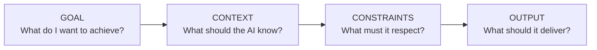

# Lesson 1 — Write a request that communicates the result you want

[← Course home](../README.md) · [Next: Context engineering →](02-context-engineering.md)

## 1. Theory — Goal, Context, Constraints, Output (GCCO)

When I ask an AI a question, it might answer the *words I wrote* rather than the outcome I actually care about. The solution isn't to add impressive-sounding language: it's to reduce the ambiguity that matters.

| Element | Question it answers | Useful example |
|---|---|---|
| **Goal** | What am I trying to achieve? | “Find a viable low-budget online business.” |
| **Context** | What situation is relevant? | “I live in Cyprus and have Computer Science skills.” |
| **Constraints** | What must it respect or avoid? | “€1,000 total; no inventory-heavy model.” |
| **Output** | What result would help me decide? | “Compare five options and recommend three.” |

This is a **thinking framework**, not a mandatory prompt template. For “What does backpropagation mean?” a short question is fine. For a decision involving money, roles, or research, the four elements become much more valuable.

## 2. Visual overview — the four building blocks



Use these four as a **checklist**, not as four paragraphs you must always write.

## 3. Worked example — vague vs precise

**Weak:** “Suggest some side hustles.”

**Stronger:** “I want to earn an extra €300–€500 per month while looking for a full-time job. I can give this 8 hours weekly and don't want cold outreach or sales. Suggest up to five realistic options available to someone in Cyprus. Compare startup cost, effort, and likelihood of consistent work; explain any assumptions.”

**Why stronger?** The assistant can filter *against your actual goal*. It doesn't have to guess whether you're looking for a full-time company, quick cash, freelancing, or an investment.

## 4. My original exercise prompt — exactly as written

> I want to open a small online business in Cyprus. I have $1000 as a budget, limited time and no business idea in mind. I want you to investigate thoroughly and make deep research in the market if this is a good idea and show the gaps or even what is working and still can work for me.

**Original feedback: 7/10**

### What I did right

- I communicated a concrete goal: a small online business in Cyprus.
- I supplied a budget and mentioned limited time.
- I asked about both **market gaps** and **existing models** that still might work; this avoids chasing novelty for its own sake.
- I requested research rather than simply asking for a random idea.

### What I needed to improve — and why

1. **“Limited time” isn't measurable.** Two hours and fifteen hours a week eliminate very different opportunities.
2. **The currency and budget coverage aren't clear.** I wrote `$1,000` whereas the lesson scenario was €1,000. A real prompt should say whether setup, marketing, software, and other costs must fit within that total.
3. **“Deep research” doesn't define evidence.** The assistant should know to find actual competitors, demand indicators, sources, costs, and counterarguments.
4. **The output is unspecified.** Should I receive 50 ideas, a market report, or a ranked shortlist? A specific deliverable makes the response actionable.
5. **The uncertainty policy is missing.** An estimate should be labelled as an estimate, not presented as proven demand or profit.

## 5. Improved prompt — detailed version

```text
I want to explore starting a small online business in Cyprus.
My total initial budget is €1,000, including setup and marketing.
I have a Computer Science background and no business idea yet.
Assume I can spend around 10 hours weekly for this example.

Research current opportunities in Cyprus, considering both
underserved needs and existing models a new competitor might enter.

For each credible option, evaluate:
- existing competitors and evidence of demand;
- setup and ongoing costs;
- operating effort and key risks;
- realistic scalability.

Use current, verifiable sources. Separate sourced facts from
illustrative calculations and unsupported unknowns.

Show up to five opportunities in a comparison table. Rank the
three strongest for my constraints, explain why, and propose an
inexpensive validation test before committing the full budget.
If the evidence is too weak, say so.
```

*The 10-hour figure is an illustrative assumption, not something the original prompt specified. Replace it with actual availability.*

### Shorter version for everyday use

```text
I have €1,000 to explore a small online business in Cyprus and
limited weekly time. Find evidence-backed options, including both
market gaps and established models. Compare actual competitors,
demand signals, startup costs, time required and major risks. Give
me the strongest three in a table with sources, clearly mark
estimates, and suggest a cheap first validation step. Ask if an
unknown time commitment would materially change the results.
```

**What made the improvement effective?** It didn't rely on “be more intelligent” or “think extremely hard.” It specified *what successful research must demonstrate*.

## 6. Better wording: what to ask instead

| Generic wording | More useful alternative |
|---|---|
| “Do deep research.” | “Find current competitors, sources, costs, demand indicators, and counterevidence.” |
| “Give the best idea.” | “Rank options against cost, time, demand evidence, and risk.” |
| “Something realistic.” | “Exclude options that exceed €1,000 or my weekly availability.” |
| “Explain everything.” | “Give a comparison table, key trade-offs, then a recommendation.” |

## 7. One-minute takeaway

> **State the outcome, provide only relevant context, quantify the limits, and define what a useful answer should contain.** A good prompt doesn't have to be long; it has to remove the ambiguity that would change the result.

**Self-check before sending:** What am I actually trying to decide or achieve? What is the assistant likely to guess wrong? What would I want to see in the final answer?

**Next:** [Lesson 2 — Select the right context →](02-context-engineering.md)