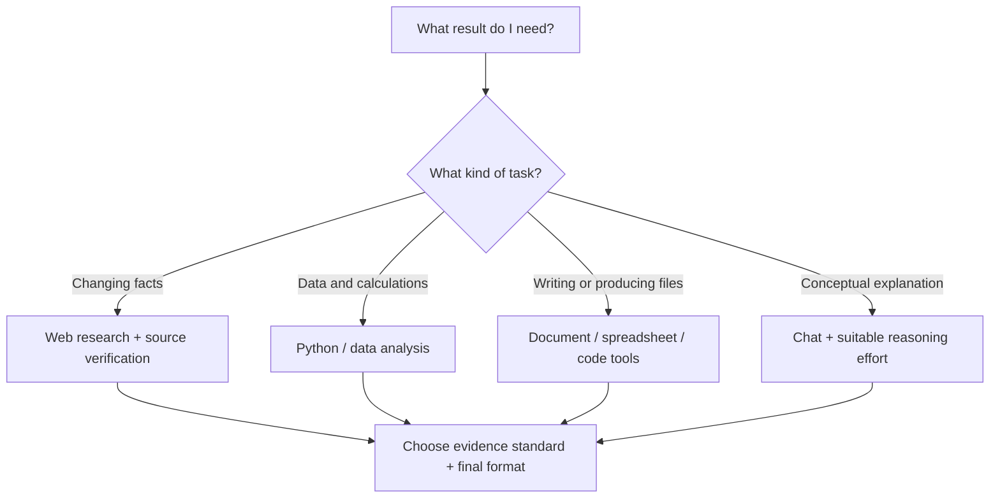

# Lesson 3 — Control research depth, tool choice, evidence, and output

[← Course home](../README.md) · [← Previous](02-context-engineering.md) · [Next →](04-iterative-prompting.md)

## 1. Theory — Control method, evidence and format

A prompt can specify more than the topic: it can define **how the work should be performed**, **what evidence is acceptable**, and **what form the result should take**.

Think of these as four separate controls:

| Control | Weak wording | Useful wording |
|---|---|---|
| **Style/depth** | “Explain better.” | “Give an undergraduate-level explanation with one worked example and no unnecessary background.” |
| **Evaluation method** | “Pick the best.” | “Compare by entry requirements, salary, career relevance, and commute; explain trade-offs.” |
| **Evidence/tools** | “Find jobs.” | “Search current official postings and check if applications are open; link sources.” |
| **Output** | “Tell me everything.” | “Return a table of five verified listings, then a prioritised action plan.” |

### Reasoning instructions vs thinking settings

You can ask for an analytical method (“compare alternatives, test assumptions, challenge my conclusion”), but that doesn't necessarily switch the underlying **thinking-effort setting** in ChatGPT. Where available, Instant is suited to everyday tasks, while higher reasoning settings can help with demanding technical problems. Choose the actual setting in the model controls; use the prompt to specify **what the analysis should cover**.

### Choose the capability, not just a magic phrase

- **Current or changing facts:** ask for web research and citations.
- **Data and calculations:** supply data and request Python or a reproducible calculation.
- **Files:** ask for an actual spreadsheet, document, PDF, or other downloadable output when needed.
- **External accounts:** supported connected apps and permissions are needed for repository or calendar operations.
- **Complex multistep tasks:** break the work into verification, analysis, recommendations, and deliverables.

No prompt can give a model real-time knowledge that it hasn't retrieved, or access to a private account without an appropriate connection.

### Specify a research standard

A request to “research thoroughly” is less useful than saying:

```text
Use current primary sources where possible. Give direct links.
Separate verified facts, estimates, and unknowns. Explain how
comparisons were made. If evidence is insufficient, say so.
```

Citations help the reader inspect claims, but citation presence alone does not prove source reliability.

## 2. Visual overview — match the method to the task



**Important:** Asking for research or analysis does not automatically grant access to private accounts or force a different model setting.

## 3. Worked example — vague research vs verifiable research

**Too vague:** “Find good entry-level jobs for me.”

**More useful:** “Search current company career pages for entry-level AI/data roles that accept candidates based in Cyprus. Show the application link, check whether the job is still open, compare the listed requirements with my skills, and flag any status you couldn't confirm.”

**Why it's better:** It specifies **where to look**, **what counts as a match**, **how to verify** and **what not to pretend to know**.

## 4. My original exercise prompt — exactly as written

> My goals is to find my first job in AI or data analytics in Cyprus. Im a Computer science graduate, with fundamental knowledge of the basic and looking to take my career to the next level by increasing my experience in the field. I have a basic understanding of ML and python through my studies, but have no professional experience. I prefer Paphos or Limassol, but im open to remote work. Im looking for entry level positions, not senior level jobs. I want you to find me currently active positions, make a list were based of my knowledge and the demands ill be a top applicant, pick 5 that are suited based on my background and have an actual chance of getting an interview based on actual reviews rather than making assumptions. Also on the list add the negatives and benefits of each job.

**Original feedback: 8/10**

### What I did right

- Defined a concrete goal: first AI/data analytics job.
- Explained current academic knowledge and lack of professional experience.
- Provided meaningful location and seniority filters.
- Asked for **five suitable positions**, with pros and cons, rather than a random list of vacancies.
- Tried to avoid unrealistic optimism by asking about actual interview chances.

### What I needed to improve — and why

1. **“Currently active” needs a verification method.** Search engines can surface expired vacancies. Check official company or application pages; disclose if status is uncertain.
2. **“Top applicant” is unprovable from public descriptions alone.** We can compare my skills with stated requirements, but can't know competing applicants.
3. **Candidate reviews aren't individual interview probabilities.** Reviews can help assess interview process or working culture, but don't establish my odds of receiving an interview.
4. **The ranking criteria weren't ordered.** Is the priority immediate eligibility, salary, proximity, or long-term ML relevance? The prompt should say.
5. **The number five shouldn't override quality.** If there are three credible matches, don't fill the list with two poor ones.

## 5. Improved prompt — ready for an actual job search

```text
I'm a Computer Science graduate with academic Python and Machine
Learning knowledge but no professional experience. I want my
first entry-level role in AI, data analytics, or a closely related
technical area.

Find currently open roles in Paphos or Limassol, Cyprus, plus
remote jobs that explicitly accept Cyprus-based applicants.
Exclude senior jobs and roles that require substantial professional
experience.

Use current web research, prioritising official career pages.
For each job provide a direct application link, the date checked,
and whether the application status was verified or unclear.

Choose up to five credible matches. For each, compare my known
skills with the published requirements, list missing skills,
explain the role's benefits and downsides, and assess career
relevance to AI/ML. Treat employee and interview reviews as
supplementary context, not proof of my interview probability.

Present a comparison table and rank the best matches, first by
realistic entry-level eligibility, then by career relevance and
location. Finish with the top three applications to prioritise.
If fewer than five suitable jobs can be verified, return fewer.
```

### Shorter version for everyday use

```text
Search live for entry-level AI/data jobs in Paphos, Limassol,
or remote jobs accepting Cyprus applicants. I have a CS degree,
academic Python/ML knowledge, and no work experience. Verify
application links; exclude senior/closed jobs. Return up to five
matches ranked by actual requirements fit, career relevance, and
location. Include gaps, pros/cons, and source links; don't invent
interview odds or fill the list with weak matches.
```

## 6. Output format and incomplete evidence

For a human decision, use a table with columns like:

| Job/company | Evidence it's open | Skills match | Missing skills | Pros/cons | Priority |
|---|---|---|---|---|---|
| *(Each row should be backed by a verified listing.)* | | | | | |

For a program, use a consistent schema (such as JSON). For a presentation, ask for an actual slide deck. **The format should match what you'll do with the result.**

### How to handle impossible instructions

**Risky:** “Find ten verified jobs and don't disappoint me.”

**Better:** “Return all credible matches up to ten; if there aren't ten, explain the gap and suggest one way to widen the search.”

This avoids pressuring the model to complete an arbitrary count at the expense of accuracy.

## 7. One-minute takeaway

> **Specify the research process, evidence requirements, prioritisation criteria, and deliverable.** If a task needs a tool, request the tool-supported work—not just a more enthusiastic paragraph.

**Next:** [Lesson 4 — Correct responses through feedback →](04-iterative-prompting.md)
