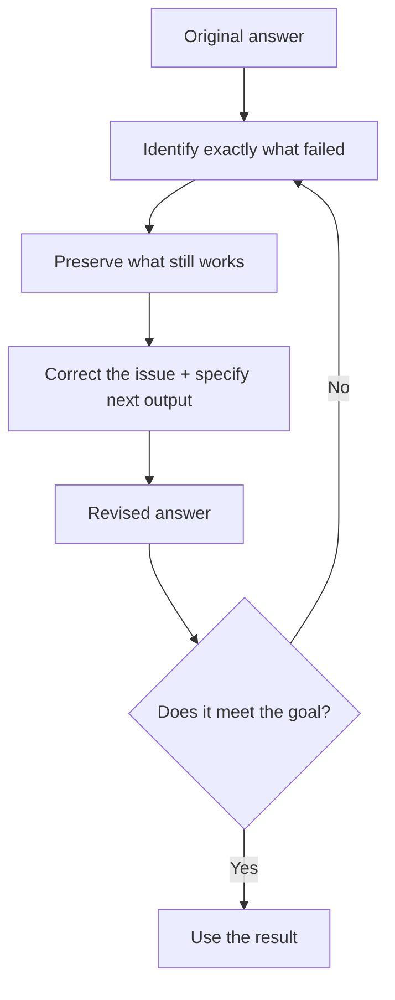

# Lesson 4 — Iterative prompting: preserve, correct, redirect

[← Course home](../README.md) · [← Previous](03-research-tools-and-format.md) · [Next →](05-zero-shot-few-shot-and-json.md)

## 1. Theory — Iterative prompting

A first response can be incomplete even when the first prompt was reasonable. A strong user can correct the response without starting again. That's **iterative prompting**: evaluate the result, identify the failure, and supply targeted feedback.

### Preserve–Correct–Redirect

This is a practical learning aid, not an official standard:

1. **Identify the failure:** What was wrong or unhelpful?
2. **Preserve the useful context:** Which goals and constraints still apply?
3. **Specify the correction:** What must change or be excluded?
4. **Define the next result:** What should the assistant now produce?

**Weak follow-up:** “I don't like these; give better ideas.”

**Strong follow-up:** “The suggestions rely on cold outreach, which I've ruled out. Keep the goal of earning €300–€500/month with no upfront investment. Exclude sales and surveys; find three viable alternatives for Cyprus, compare required effort, and mark unverified earnings claims.”

## 2. Visual overview — the feedback loop



This is a **feedback loop**, not a requirement to rewrite the entire original request every time.

### Small feedback commands that often work

- **Narrow:** “Focus only on roles requiring no professional experience.”
- **Redirect:** “Keep the analysis, but optimise for skills growth rather than salary.”
- **Challenge:** “List the assumptions that would change your conclusion.”
- **Reformat:** “Keep the findings but convert them into a two-column comparison.”
- **Verify:** “Recheck those specific claims against primary sources.”
- **Preserve:** “Keep all confirmed constraints; change only the budget.”

When a response is factual and important, independent source verification is stronger than asking the model merely to “critique itself.”

## 3. Worked example — the disappointing response

I had asked for realistic small online businesses in Cyprus with a €1,000 budget, a Computer Science background, 10 hours per week, and low startup costs.

The disappointing AI response suggested:

1. Dropshipping.
2. A social media marketing agency involving local business outreach.
3. A YouTube channel.

It also called them profitable or promising without presenting supporting research.

## 4. My original follow-up prompt — exactly as written

> The ideas you gave me are generic and based on zero evidence this will work in my position, also i dont like to do something generic like dropshipping or a youtube channel based on the popularity. Keep in mind the 1000 euro budget i have and that i want to start a small online business in Cyprus, also my background and my hours i can dedicate per week. I want you to make a thorough research on realistic opportunities and gaps the market has or even active working models that could work for me, having as a strong preference low start up cost. I want evidence based on cost and different metrics that are relevant to each business, for example demand and categorize them based on my preferences giving also the benefits and the negatives. If theyre is uncertainty keep it to the facts rather than giving me estimates or mentioning that its a domain that is quite unkown. Make a list of each business model, telling me the difficulties or costs and what has the most upscale potential and narrow it down to 3 you recommend most for my situation.

**Original feedback: 9/10**

### What I did right

- **Named the actual problem:** generic, popularity-based ideas with no evidence.
- **Excluded unwanted options:** dropshipping and content creation chosen solely because they're fashionable.
- **Preserved context:** €1,000 budget, Cyprus, skills, 10 hours per week.
- **Specified evaluation:** costs, demand, benefits, downsides, difficulty, scalability.
- **Requested a decision:** the three strongest opportunities for my situation.

### What I needed to improve — and why

The main issue was the sentence about uncertainty:

> “If theyre is uncertainty keep it to the facts rather than giving me estimates or mentioning that its a domain that is quite unkown.”

The intention was good—I didn't want invented numbers. But suppressing estimates or discouraging the assistant from mentioning unknowns can hide risk.

Distinguish these:

- **Unsupported claim:** “This business will earn €2,000 monthly.”
- **Transparent calculation:** “At an illustrative €40 per sale and 20 sales, gross revenue would be €800; 20 sales is not verified demand.”
- **Unknown:** “No dependable local demand estimate was found.”

Good analysis clearly labels **facts, assumptions, calculations, and unknowns**. It does not erase uncertainty.

The second missing detail: I asked for “thorough research” but didn't specify current web sources, real competitors, and citations.

## 5. Improved follow-up — detailed version

```text
The previous ideas were generic and not supported by evidence.
Don't recommend dropshipping or content creation simply because
they're popular. Keep the €1,000 budget, Cyprus focus, my CS
background, and 10-hour weekly limit.

Redo the research with current sources. Consider underserved
market needs and viable existing models. Compare real competitors,
demand evidence, upfront/ongoing costs, effort, risks, and ability
to scale. Separate verified facts from estimates and unknowns;
show assumptions behind calculations.

Rank the opportunities for my situation, give pros and cons,
and recommend the top three with low-cost tests. If you can't
support an opportunity with evidence, state that limitation.
```

### Shorter version for everyday use

```text
These ideas are generic and unsupported. Keep my existing Cyprus,
€1,000, technical-background, and 10-hours/week constraints.
Exclude popularity-only ideas like dropshipping or YouTube.
Research current competitors, costs, and demand signals; label
facts vs estimates vs unknowns. Return a comparison and the top
three evidence-backed opportunities, including risks and a cheap
test for each. Don't pad the list if the evidence is weak.
```

## 6. When to continue vs start a new conversation

| Continue the current conversation | Start fresh |
|---|---|
| Revising a recommendation using the same facts | Testing prompts without prior-chat context |
| Changing one named constraint | Earlier assumptions are conflicting or overwhelming |
| Refining one project or deliverable | Starting an unrelated task |
| Asking for a corrected output | Comparing models/prompt variants under controlled conditions |

### Long-conversation checkpoint

```text
Before continuing, summarise the goal, decisions, constraints,
what has been verified, what remains uncertain, and our next action.
Flag any contradictions.
```

## 7. One-minute takeaway

> **Don't just say “try again.” Tell the assistant what failed, what stays, what changes, and what you want next.** The strongest feedback preserves progress while correcting direction.

**Next:** [Lesson 5 — Learn the technical prompting techniques with examples →](05-zero-shot-few-shot-and-json.md)