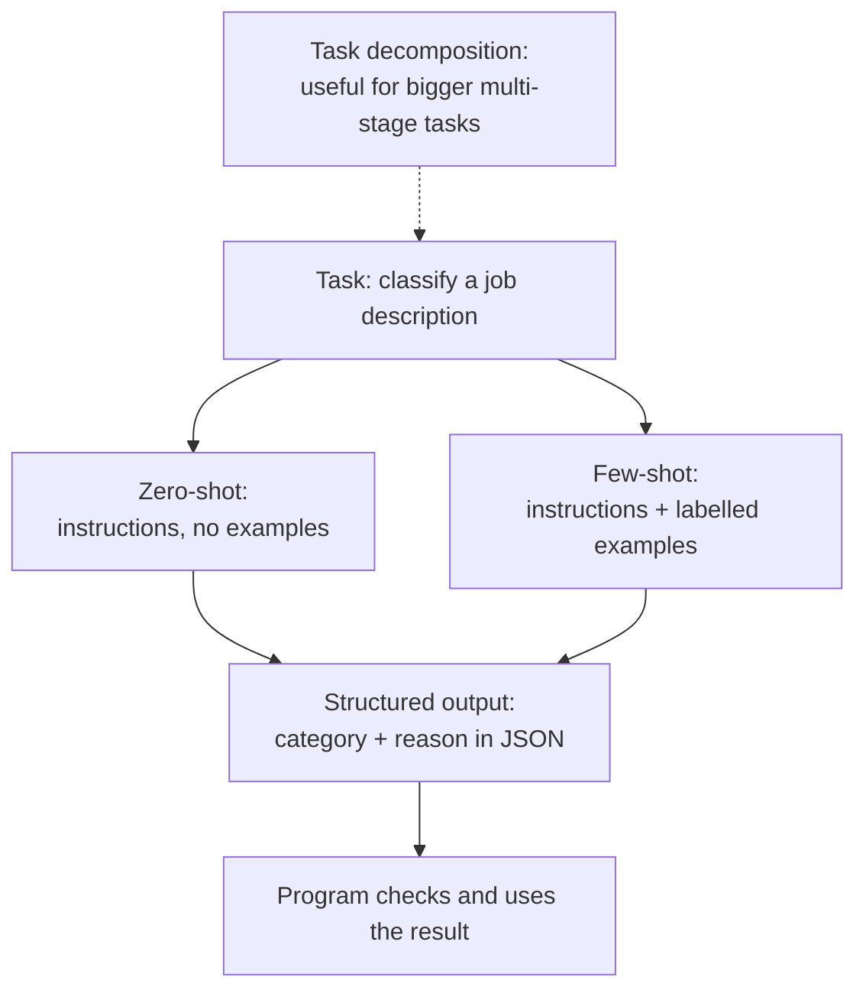

# Lesson 5 — Zero-shot, few-shot, structured outputs, and task decomposition

[← Course home](../README.md) · [← Previous](04-iterative-prompting.md) · [Next →](06-real-world-workflows.md)

> **A note about this lesson:** In the original course I was asked to design a technical classification prompt *before* seeing enough complete, worked examples. The 5/10 score recorded below reflects that exercise and feedback, but it was not a fair measure of my ability. This page teaches the topic properly from the beginning.

## 1. Theory and worked examples

### Zero-shot — instructions without demonstrations

Zero-shot means **giving a task without showing labelled examples**. You can still provide rules and formatting requirements.

```text
Classify this job description as Data Analyst, Data Scientist,
ML Engineer, or Other. Choose based on the main responsibilities.
Return only the category.

Job: "Build dashboards with SQL and Power BI."
```

**Illustrative answer:** `Data Analyst`

**Use when:** The task is familiar, the categories are reasonably clear, and you'd like a simple baseline. Always consider whether zero-shot is already good enough before complicating the prompt.

### Few-shot — demonstrate the pattern

Few-shot means giving **a handful of correctly labelled input/output examples** so the model can see the desired pattern.

```text
Classify a role as Data Analyst, Data Scientist, ML Engineer,
or Other. Base the label on primary responsibilities.

Example 1:
Input: "Create SQL dashboards for sales reporting."
Output: Data Analyst

Example 2:
Input: "Run experiments and develop predictive models."
Output: Data Scientist

Example 3:
Input: "Deploy inference services and monitor ML models."
Output: ML Engineer

Example 4:
Input: "Develop HTML and CSS web pages."
Output: Other

Now classify:
Input: "Maintain production ML endpoints and model monitoring."
Output:
```

**Illustrative answer:** `ML Engineer`

**Use when:** Classes have non-obvious boundaries, the task uses a custom convention, or a zero-shot baseline performs inconsistently.

**Watch out:** More examples don't automatically improve results. Poor or unrepresentative examples can bias responses. Keep demonstrations separate from the final test set if you evaluate performance.

### Structured output — define the required fields

An answer might be correct in natural language but awkward for a Python script. With structured output, you request predictable fields.

**Weak for machine use:** “It's an ML Engineer role because it involves production deployment.”

**Stronger for machine use:**

```json
{
  "category": "ML Engineer",
  "reason": "The role centres on running ML models in production."
}
```

A prompt can request JSON, but a prompt alone doesn't guarantee valid JSON. In an application, use a schema-enforced response feature when available, plus parsing/validation and handling of errors.

### Smallest useful JSON instruction

```text
Return exactly one valid JSON object with these two keys:
- category: one of "Data Analyst", "Data Scientist",
  "ML Engineer", "Other"
- reason: a one-sentence explanation

No Markdown fences and no text outside the JSON object.
```

For a Python script, you might later do:

```python
import json

result = json.loads(model_response_text)  # only if valid JSON
category = result["category"]
reason = result["reason"]
```

In production code, validate that the category is allowed and `reason` is a string. This snippet assumes a successful model response and is **not** itself a model call.

### Task decomposition — split complex work into stages

Rather than “Research whether I should start a business,” specify steps:

```text
1. Find current competitors and evidence of customer need.
2. Compare price points and potential underserved segments.
3. Estimate setup costs with transparent assumptions.
4. Identify reasons the business might fail.
5. Rank opportunities and propose a cheap validation test.
```

**Use when:** A task has dependencies, multiple sources, calculations, or decisions. For important work, inspect intermediate results before relying on the final conclusion. Don't turn a simple question into a needlessly complex workflow.

## 2. Visual overview — four techniques and their jobs



These are **techniques, not performance guarantees**. A simple task may need only zero-shot; a program may also need schema validation.

## 3. Complete worked example — combining techniques

Imagine a model is used inside Python to classify job descriptions into four categories. A robust single-prompt example might be:

```text
TASK
Classify the job description into exactly one category:
Data Analyst, Data Scientist, ML Engineer, or Other.

RULES
- Data Analyst: reporting, dashboards, business insights,
  data queries.
- Data Scientist: statistical experiments, predictive model
  development, data science analysis.
- ML Engineer: deploying, integrating, monitoring, or maintaining
  ML systems in production.
- Other: unrelated role or insufficient evidence.
- Choose the dominant responsibilities, not a keyword count.
- If responsibilities overlap, choose the dominant function and
  explain the choice. If evidence is insufficient, choose Other.

EXAMPLES
Input: "Create dashboards using SQL and Power BI."
Output category: Data Analyst

Input: "Build predictive models and run experiments."
Output category: Data Scientist

Input: "Deploy models using Docker and production APIs."
Output category: ML Engineer

Input: "Build web pages with HTML and CSS."
Output category: Other

OUTPUT
Return one JSON object containing exactly these fields:
- category: one of the four labels above
- job_title: string or null
- seniority: string or null
- required_skills: array of strings (empty if not specified)
- reason: one short natural-language sentence
Don't invent details. Don't write anything outside the JSON.

JOB DESCRIPTION
[INSERT ONE DESCRIPTION HERE]
```

It combines **few-shot demonstrations**, **decision rules**, **structured output**, and **missing-information handling**. If we later compare versions experimentally, we must hold everything constant except the technique we are testing.

### What the JSON looks like in practice

For the illustrative input **“Maintain production inference APIs using Python and Docker”**, the desired output could be:

```json
{
  "category": "ML Engineer",
  "job_title": null,
  "seniority": null,
  "required_skills": ["Python", "Docker"],
  "reason": "The main responsibility is maintaining production ML inference services."
}
```

The key detail is that **`reason` belongs inside the JSON**, not in a paragraph after it. A basic Python program can read it like this:

```python
import json

raw_response = '{"category":"ML Engineer","reason":"Production ML deployment."}'
result = json.loads(raw_response)
assert result["category"] in {"Data Analyst", "Data Scientist", "ML Engineer", "Other"}
print(result["category"], "—", result["reason"])
```

This is a demonstration of **parsing**, not a complete application. For production use, validate the *full* schema and handle invalid responses; where available, use a schema-enforced output mode.


## 4. My original exercise prompt — exactly as written

**Techniques I selected:** Few-shot, Structured output.

> classify the job descriptions into four categories: Data Analyst, Data Scientist, ML Engineer, Other.
> Extract the job title, seniority and required technologies. Return a JSON object with the keys job_title, seniority and required_skills. Use null when the title or seniority is not provided. Do not invent missing information. Also except from the json file give me also a natural langauge answer about the reason

**Original feedback: 5/10 — with the teaching caveat noted at the top of this page.**

### What I did right

- Selected two relevant techniques for an application that will eventually be written in Python.
- Thought about **missing fields** and requested `null` rather than fabricated titles/seniority.
- Wanted both structured data for a program and an explanation a person can read.

### What I needed to improve — and why

1. **No actual few-shot examples.** Selecting the technique in a form is not the same as providing demonstrations in the prompt. Written as-is, this was a zero-shot prompt.
2. **The JSON omitted `category`.** The task was classification, but the fields requested were only `job_title`, `seniority`, and `required_skills`. The model could follow the format and still fail to report the classification.
3. **Natural language outside JSON conflicts with easy parsing.** Better to put a `reason` string *inside* the JSON.
4. **No overlap policy.** A job mentioning both model training and deployment could fit more than one class; define how to choose.
5. **No input placeholder.** A reusable prompt should show where the new job description goes.

## 5. Improved prompt — concise version

```text
Classify the following job description into exactly one category:
Data Analyst, Data Scientist, ML Engineer, or Other.
Choose by the role's main responsibilities, not keywords alone.

Examples:
"Build SQL dashboards" → Data Analyst
"Develop predictive models" → Data Scientist
"Deploy ML models to production APIs" → ML Engineer
"Build websites with HTML/CSS" → Other

Return only a valid JSON object with:
category, job_title, seniority, required_skills, reason.
Use null for missing title/seniority and [] for unspecified skills.
The reason should be one natural-language sentence inside JSON.
If the category is unclear, use Other and explain the uncertainty.
No text outside JSON.

Job description: [PASTE HERE]
```

## 6. Choosing the technique

| Situation | Good starting point | Why |
|---|---|---|
| Standard classification | Zero-shot | Test simplest prompt first |
| Unusual or ambiguous categories | Few-shot + clear rules | Demonstrates difficult boundaries |
| Model response consumed by code | Structured output | Easier to validate and parse |
| Long market or technical investigation | Decomposition | Makes dependencies and review points explicit |
| Complex agent application | Combine as needed | Different workflow stages may need different methods |

## 7. One-minute takeaway

> **A technique has to be implemented, not just named.** Zero-shot asks, few-shot demonstrates, structured output defines a machine-readable contract, and decomposition organises multistep work. Start simple and test what genuinely helps.

**Next:** [Lesson 6 — Combine the lessons into practical workflows →](06-real-world-workflows.md)