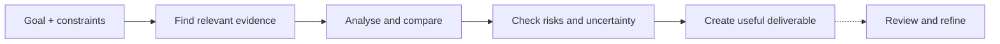

# Lesson 6 — Combine everything: use ChatGPT as a practical work assistant

[← Course home](../README.md) · [← Previous](05-zero-shot-few-shot-and-json.md) · [Phrasebook →](../PROMPT-PHRASEBOOK.md)

## 1. Theory — From questions to useful work

The biggest improvement in using ChatGPT is often **not** a new prompting trick. It's learning to define a whole task with an evidence standard, method, review points, and deliverable.

You can ask for:

- **Understanding:** “Explain this concept at my current technical level.”
- **Research:** “Verify what is currently available using sources.”
- **Analysis:** “Evaluate the options against my priorities.”
- **Execution:** “Create a spreadsheet, report, draft, prototype, or code file.”
- **Review:** “Show me what you produced, limitations, and what to do next.”

Don't ask for a huge workflow when a two-sentence explanation will do. Match the task's complexity.

## 2. Visual overview — a complete practical workflow



Not every question requires this entire workflow. Use it when your goal is more than a simple explanation.

## 3. Worked example — from an idea to a feasibility report

**Generic:** “Is this business idea good?”

**More powerful, but grounded:**

```text
Goal: Decide whether a small online service in Cyprus is worth
validating before spending money.

Context: I have a CS background, a €1,000 total initial budget,
and at most 10 hours weekly.

Method:
1. Find actual local competitors and their published offerings.
2. Investigate evidence of demand, noting gaps in public data.
3. Build a simple cost and revenue-scenario model with explicit
   assumptions rather than invented profit predictions.
4. Explain the strongest reasons the idea might fail.
5. Propose one cheap experiment that could validate demand.

Evidence: Use current sources and link important claims. Clearly
separate sourced facts, estimates, and unknowns.

Output: Give me a concise feasibility summary, a comparison table,
and an editable cost spreadsheet. Ask about any missing constraint
that would materially change the decision; otherwise state the
assumption you use.
```

This isn't “the best prompt” for every business. It's a useful reference because each sentence serves a specific purpose.

### Review before acting

An even safer approach for consequential work is two-stage:

**Stage A — evidence:** “Research the market and show sources, limitations and contradictions. Do not recommend yet.”

**Stage B — decision:** “Using the verified findings, model costs, explain risks and give a recommendation.”

That gives you a chance to catch unsupported assumptions before they shape the conclusion.

## 4. Pick the right capability

| What I actually need | Appropriate approach |
|---|---|
| Explain an established concept | Ordinary chat; ask for a level and example |
| Current laws, news, jobs, pricing or products | Current web research; verify dates and sources |
| Spreadsheet data, calculations, modelling | Python/data analysis or a generated spreadsheet |
| Upload a CV or research paper and analyse it | Provide the file; ask specific comparison questions |
| A logo, visual concept or image edit | Image generation/editing |
| A finished guide, slide deck, PDF or workbook | Ask for a downloadable artifact, not just instructions |
| Change a GitHub repository or connected account | Use an authorised integration; approve write actions |
| Navigate websites as part of a multistep task | Supported Work/browser features, if available |

**A prompt doesn't override the limits of a tool or subscription.** Private accounts require connections/permissions; current facts need retrieval; sensitive decisions need scrutiny. Writing “use deep thinking” does not itself switch model effort settings.

## 5. Improved reusable prompt — the final template

Use this when the task is important enough to justify explicit instructions:

```text
I'm trying to [GOAL].
Relevant context: [BACKGROUND].
Constraints: [BUDGET/TIME/LOCATION/EXCLUSIONS].

Please [SPECIFIC TASK]. Use [METHOD OR TOOL] where relevant.
Prioritise [MY MAIN CRITERIA]. Verify [IMPORTANT CLAIMS].
Distinguish facts, estimates, and unknowns.

Return [FORMAT/DELIVERABLE] and recommend the next action.
If something essential is unclear, ask one focused question;
otherwise proceed with transparent assumptions.
```

You can omit lines that don't matter. **Conciseness without losing critical information** is the aim.

## 6. Better wording in everyday use

- “Explain this at undergraduate CS level, with a worked example and one common mistake.”
- “Compare these three options using cost, risk, and career relevance. Rank them and explain the ranking.”
- “Search for current information and provide primary-source links. Tell me what couldn't be verified.”
- “Keep our earlier constraints; change only the salary to €2,000.”
- “Don't rewrite everything. Point out the three most important flaws and correct those sections.”
- “Create the actual Excel workbook with formulas and give me the file.”
- “Before recommending an investment, identify the assumptions that could invalidate the conclusion.”
- “I need working Python code. Explain how to run it, then provide one test case and expected result.”

### Quality-control checklist before sending

1. **Outcome:** Could someone else describe exactly what I'm trying to achieve?
2. **Context:** Did I include only details that affect the answer?
3. **Constraints:** Are the important limits specific and measurable?
4. **Method:** Is this an explanation, fresh research, calculation, program, or file creation?
5. **Evidence:** Does the task require sources, traceable assumptions, or explicit uncertainty?
6. **Priorities:** If trade-offs arise, have I said what matters most?
7. **Output:** Is the deliverable suitable for how I'll use it?
8. **Failure handling:** What should happen if evidence is missing, sources conflict, or no good options are found?

## 7. My Lesson 6 outcome — no submitted exercise

There was **no scored writing exercise** in Lesson 6. The purpose was to combine the prior techniques into real-world work, understand tool selection, and create this reusable guide. The critical lessons from earlier exercises remain:

- **L1:** Define the goal, context, constraints, and requested result.
- **L2:** Provide relevant background *and* an explicit task.
- **L3:** Set evidence standards, tool expectations, ranking criteria, and output format.
- **L4:** Correct precisely while preserving useful context; acknowledge uncertainty.
- **L5:** Implement technical patterns correctly and test whether they help.

## 8. What comes next

A future small project can use ~30 held-out job descriptions to test prompts for classification. Keep the **model**, **task**, **label definitions**, and **test items** stable; compare zero-shot, few-shot and structured-output versions while recording accuracy, JSON validity, costs/tokens, latency, and errors. Don't claim an approach is superior before running the tests. API usage may be separately billed, so budget and track it deliberately.

## 9. One-minute takeaway

> **Think in outcomes, evidence, tools, and deliverables—not “magic words.”** Ask for the simplest workflow that can actually produce a trustworthy result, inspect what it produces, then refine it.

**Go next:** [Phrasebook — replace vague instructions →](../PROMPT-PHRASEBOOK.md) · [Back to course home](../README.md)
